  

  
  
  
  
  
  
  

---

# ⚡ Awesome Event-Driven Component Framework

> 🚀 **A curated index of enterprise SaaS platforms and battle-tested open-source projects powering Event-Driven Component Architectures, Reactive UI Bindings, and Low-Code Application Composition.**

Event-driven component frameworks empower developers, platform engineers, and enterprise architects to assemble applications where reusable UI widgets communicate seamlessly via event buses, state listeners, and reactive bindings — eliminating fragile imperative glue code.

---

## 📑 Table of Contents

- [📊 Sector Overview & Market Dynamics](#-sector-overview--market-dynamics)
- [☁️ SaaS / Hosted Platforms](#️-saas--hosted-platforms)
- [🐙 Open-Source GitHub Projects](#-open-source-github-projects)
- [🧩 Architectural Comparison & Synthesis](#-architectural-comparison--synthesis)
- [🤝 How to Contribute](#-how-to-contribute)
- [⚖️ License](#️-license)
- [⭐ Star History](#-star-history)

---

## 📊 Sector Overview & Market Dynamics

The global **Low-Code Development & Internal Tool Frameworks** market is estimated at **$28.5 Billion in 2024–2025** and is projected to surpass **$65–$70 Billion by 2030**, advancing at a robust compound annual growth rate (**CAGR of ~22.5%**). Growth is propelled by accelerating enterprise demand for developer velocity, AI-assisted app authoring, and composable micro-frontend ecosystems.

**Market Concentration & Fragmentation**:
The sector is **moderately fragmented**:
- **Enterprise Suites (Concentrated Tier)**: Trillion-dollar mega-cap ecosystems like **Microsoft Power Apps (PCF)** and **Salesforce Lightning** hold significant market share across large enterprises with CRM/ERP-centric workloads.
- **Developer-First & Open-Core Innovators (Fragmented Tier)**: Specialized low-code platforms (such as **Retool**, **Appsmith**, **Budibase**, **ToolJet**, and **Superblocks**) vigorously compete for modern engineering and platform teams that demand fine-grained JavaScript/TypeScript runtime control, VPC/self-hosting privacy, and headless component flexibility.

---

## ☁️ SaaS / Hosted Platforms

The following SaaS and managed cloud platforms represent category leaders in event-driven UI composition and low-code app development. Entries are sorted descending by **Company Valuation / Revenue**.

| Platform / Product | 🏢 Company Valuation / Revenue | 💳 Starting Paid Tier Pricing | 🎁 Free Tier / Trial Limits | ⚙️ Core Event Architecture & Reactive Mechanisms |
| :--- | :--- | :--- | :--- | :--- |
| **[Microsoft Power Apps (PCF)](https://powerapps.microsoft.com/)** | **$3.1T Market Cap** / **$245B Annual Revenue** | **$5/user/app/month** (or **$20/user/month** for unlimited apps) | **Free forever Developer Plan** (unlimited apps for development and prototyping, 3 environments, Dataverse included) | Power Apps Component Framework (PCF) with manifest-driven event definitions, `notifyOutputChanged()` reactive lifecycle methods, and bi-directional context bindings. |
| **[Salesforce Dynamic Interactions](https://developer.salesforce.com/docs/platform/lwc/guide/use-config-for-app-builder-dynamic-interactions.html)** | **$285B Market Cap** / **$37.9B Annual Revenue** | **$25/user/month** (Salesforce Platform Starter, billed annually) | **Free forever Developer Edition org** (2 full Salesforce Developer seats, 5MB data storage, 20MB file storage, full REST/SOAP APIs) | Lightning App Builder event binding via `targetConfig` metadata schemas in `.js-meta.xml`. LWC source components fire custom events consumed declaratively by Aura/LWC target components. |
| **[Internal.io](https://www.hubspot.com/)** *(Acquired by HubSpot)* | **$28B Market Cap** / **$2.6B Annual Revenue** | **$25/user/month** *(original rate; now part of HubSpot Operations/Service Pro at $15–$20/seat/mo)* | **14-day free trial** with full platform capabilities, unlimited datasources, and staging environments | Auto-generated event-driven functions from attached databases and APIs; reactive relationship graphs across disparate enterprise services. |
| **[Retool](https://retool.com/)** | **$3.2B Valuation** (Series C) / **~$100M+ ARR** | **$10/user/month** ($10/builder/mo + $5/end-user/mo on Team plan, billed annually) | **Free forever for up to 5 users** (unlimited web & mobile apps, 500 workflow runs/month, 5GB Retool DB storage, 250 AI credits/month) | React/TypeScript component runtime, global reactive `{{ }}` dependency graphs, event handlers (`triggerQuery`, `setValue()`), and bidirectional component bridges (`Retool.connectReactComponent()`). |
| **[Superblocks](https://superblocks.com/)** | **$150M Valuation** / **~$15M ARR** | **$100/month** (Teams plan, billed annually; covers up to 15 builders & unlimited end-users) | **14-day free trial** of Teams plan (up to 15 builders, unlimited end users, customer VPC agent connectivity) | Hybrid control plane with VPC data plane execution. Reactive component bindings, event streaming endpoints, and zero-inbound-port firewall architecture. |
| **[Appsmith (Cloud)](https://appsmith.com/)** | **$150M Valuation** (Series B) / **~$12M ARR** | **$15/user/month** (Business tier, billed annually; or **$0.40/user/hour** capped at $20/user/mo) | **Free forever Cloud Community tier for up to 5 users** (5 workspaces, 3 Git repositories, unlimited public & private apps, or unlimited self-hosted Community) | Reactive MVC binding engine (`{{ }}` expressions). Automatic dependency graph recalculation updating widgets without imperative event glue code. |
| **[Budibase (Cloud)](https://budibase.com/)** | **$45M Valuation** / **~$5M ARR** | **$19/user/month** (Pro plan, billed annually; or **$23/user/month** billed monthly) | **14-day free trial** of Pro/Premium Cloud plans (or 100% free forever self-hosted open-source edition with unlimited users and apps) | Composable Blocks hierarchy (Data Provider $\rightarrow$ Repeater $\rightarrow$ Component), global scoped `{{ }}` context bindings, and serverless automation action pipelines. |
| **[ToolJet (Cloud)](https://tooljet.com/)** | **$35M Valuation** / **~$4M ARR** | **$24/builder/month** (Business tier, billed annually) | **Free forever Cloud tier for up to 2 builders & 50 end-users** (2 applications, 100 AI credits/month, or unlimited self-hosted Community) | Module-based component data flow, bidirectional parent/module parameters (`{{input.data}}`), and visual event-driven workflow nodes. |
| **[DronaHQ](https://dronahq.com/)** | **$30M Valuation** / **~$6M ARR** | **$100/month** (Starter plan, billed annually at $1,200/yr; includes unlimited users & 25,000 tasks/month) | **30-day free trial** of Business plan with unrestricted access, unlimited users, and full connector suite (no credit card required) | Containerized micro-app runtime (Web, iOS, Android), JSON Schema event bindings, and AI agent UI action runners. |
| **[UI Bakery](https://uibakery.io/)** | **$20M Valuation** / **~$3M ARR** | **$20/developer/month** (Builder plan, billed annually) | **Free forever plan for unlimited developers & public apps** (prototyping tier with trial AI credits, 1 workspace environment, unlimited data sources) | Visual component composability with `{{ui.component.value}}` variables, action result mapping (`{{actions.actionName.data}}`), and expand-to-fit container layouts. |
| **[Lowcoder (Cloud)](https://lowcoder.cloud/)** | **$12M Valuation** / **~$2M ARR** | **€459/instance/month** (flat-rate self-hosted Enterprise instance; or $11/mo third-party managed dedicated cloud) | **Free forever shared public cloud (`app.lowcoder.cloud`)** (unlimited prototyping apps and users) or free self-hosted AGPL-3.0 edition | 120+ built-in widgets, bi-directional property/event/method APIs (`setValue()`, `resetValue()`), and native embedding without iframes. |

---

## 🐙 Open-Source GitHub Projects

Explore the most prominent open-source event-driven component frameworks, low-code builders, and reactive application platforms. Sorted descending by **GitHub Star Count**.

- **[NocoDB](https://github.com/nocodb/nocodb)**   
  Open-source smart spreadsheet and relational app builder (AGPL-3.0). Connects to MySQL, PostgreSQL, SQL Server, and SQLite. Features an API-first architecture, reactive grid component interactions, webhooks, and event-triggered automations.

- **[Payload CMS](https://github.com/payloadcms/payload)**   
  Code-first full-stack TypeScript framework (MIT) with modular React UI components. Provides event-driven document lifecycle hooks (`beforeChange`, `afterRead`), native GraphQL/REST generation, and headless application composition.

- **[ToolJet](https://github.com/ToolJet/ToolJet)**   
  Open-source low-code platform (AGPL-3.0) with module-based component composition. Supports bidirectional event parameters between parent and child modules (`{{input.userData}}` $\leftrightarrow$ `{{components.<module>.submittedData}}`) and visual workflow automation nodes.

- **[Appsmith](https://github.com/appsmithorg/appsmith)**   
  Open-source low-code internal tool builder (Apache-2.0) featuring 45+ UI widgets and 50+ datasource connectors. Uses declarative JS bindings (`{{ }}`) with an automatic reactive dependency engine that recalculates widget states on data changes without imperative event listeners.

- **[Directus](https://github.com/directus/directus)**   
  Real-time open data platform and application engine (BOSL-1.0). Provides a dynamic Vue.js administrative app with modular reactive component displays, custom interface extensions, and event-driven data flows.

- **[Refine](https://github.com/refinedev/refine)**   
  Headless React framework (MIT) for building enterprise internal tools, admin panels, and CRUD apps. Decouples business logic and state from UI presentation; provides event-driven hooks for data access, routing, access control, and live notifications.

- **[Budibase](https://github.com/Budibase/budibase)**   
  Open-source low-code platform (GPL-3.0) with a composable Blocks system. Pre-assembled blocks (Cards, Forms, Repeaters, Charts) encapsulate nested UI structures with scoped reactive bindings (`{{ MyFormBlock.Fields.Email }}`) and built-in automation pipelines.

- **[React Admin](https://github.com/marmelab/react-admin)**   
  Frontend B2B application framework (MIT) based on React and Material UI. Employs an event-driven controller-view design with declarative data bindings, optimistic UI updates, and pub/sub side effects.

- **[Activepieces](https://github.com/activepieces/activepieces)**   
  Open-source business automation and event orchestration framework (MIT). Delivers piece-based component bindings, trigger-action event routing, webhook listeners, and visual workflow builders.

- **[Node-RED](https://github.com/node-red/node-red)**   
  Classic low-code event-driven flow programming framework (Apache-2.0). Connects physical hardware devices, Web APIs, and online services via message-driven nodes operating on a lightweight Node.js event runtime.

- **[Windmill](https://github.com/windmill-labs/windmill)**   
  Ultra-fast developer platform for internal tools and event-driven workflows (AGPL-3.0). Auto-generates user interfaces from Python, TypeScript, and Go scripts with real-time reactive execution and job scheduling.

- **[ILLA Builder](https://github.com/illacloud/illa-builder)**   
  Open-source low-code development suite (Apache-2.0) with drag-and-drop reactive widgets, event action chains, database connectors, and AI agent integration.

- **[Baserow](https://github.com/baserow/baserow)**   
  Open-source no-code database and modular application builder (MIT). Built on Django and Nuxt.js, featuring real-time WebSocket event synchronization, calculated formula fields, and extensible view components.

- **[Lowcoder](https://github.com/lowcoder-org/lowcoder)**   
  Open-source Retool alternative (AGPL-3.0) with 120+ built-in components. Select and MultiSelect widgets expose dedicated `Change`, `Focus`, and `Blur` event triggers, alongside programmatic APIs (`setValue()`, `resetValue()`).

- **[UI Bakery Self-Hosted](https://github.com/uibakery/self-hosted)**   
  Docker Compose and Helm orchestration repository for UI Bakery on-premises deployment. Packages visual component canvases with expand-to-fit layouts and cross-action reactive variable bindings.

---

## 🧩 Architectural Comparison & Synthesis

| Architectural Pattern | Primary Pioneers | Event Communication Mechanism | Developer Customizability | Best Suited For |
| :--- | :--- | :--- | :--- | :--- |
| **Manifest-Driven Event Bus** | Salesforce LWC, Microsoft PCF | Metadata XML schema declaration + custom event dispatch | Strict SDK / Typed contracts | Regulated enterprise ecosystems, CRM extensions |
| **Reactive Expression Graphs** | Appsmith, Retool, UI Bakery | Declarative `{{ }}` AST evaluation & automatic dependency recalculation | Custom React/TS components + JS expressions | High-velocity internal apps, database frontends |
| **Modular Hierarchical Scoping** | Budibase, ToolJet, Lowcoder | Explicit input/output parameter channels & block nesting | Custom plugins, self-hosted Docker extensions | Multi-page enterprise tools, modular team apps |
| **Headless UI Component Hooks** | Refine, React Admin | React Hooks (`useList`, `useTable`), context pub/sub | Complete frontend framework autonomy | Custom branded portals, customer-facing B2B apps |
| **Flow-Based Event Orchestration** | Node-RED, Activepieces, Windmill | Message pipeline packets (`msg.payload`), asynchronous queues | Python, TypeScript, Node.js scripts | IoT event streams, workflow automations, webhooks |

---

## 🤝 How to Contribute

Contributions from the developer and low-code community are warmly welcomed! 🌟

1. 🍴 **Fork the repository** to your GitHub account.
2. 📝 **Add or update an entry** in [README.md](README.md) following the established table and markdown formats.
3. 🔍 **Ensure factual accuracy**: Include official links, explicit starting tier prices, specific free tier limits, and verifiable star links.
4. 🚀 **Submit a Pull Request** with a concise description of your additions.

---

## ⚖️ License

To the extent possible under law, [Ishan Dutta](https://github.com/ishandutta2007) has waived all copyright and related rights to this work.

---

## ⭐ Star History

<a href="https://www.star-history.com/?repos=ishandutta2007%2FAwesome-Event-Driven-Component-Framework&type=date&legend=bottom-right">
<picture>
<source media="(prefers-color-scheme: dark)" srcset="https://api.star-history.com/chart?repos=ishandutta2007/Awesome-Event-Driven-Component-Framework&type=date&theme=dark&legend=bottom-right" />
<source media="(prefers-color-scheme: light)" srcset="https://api.star-history.com/chart?repos=ishandutta2007/Awesome-Event-Driven-Component-Framework&type=date&legend=bottom-right" />

</picture>
</a>

<!-- SEO Keywords (Hidden)
Event-Driven Architecture Event-Driven Component Framework Reactive UI Components Low-Code Application Platforms Internal Tools Builders Dynamic Interactions Salesforce Lightning PCF Power Apps Component Framework Retool Appsmith Budibase ToolJet NocoDB Refine React-Admin Payload CMS Directus Activepieces Node-RED Windmill ILLA Builder Baserow Lowcoder UI Bakery Micro-Frontends Reactive State Management Webhook Orchestration Composable UI Frameworks Declarative Bindings Open-Source Developer Tools Awesome List Curated Resources
-->
